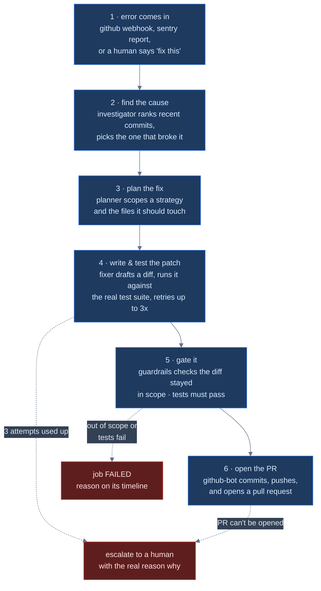
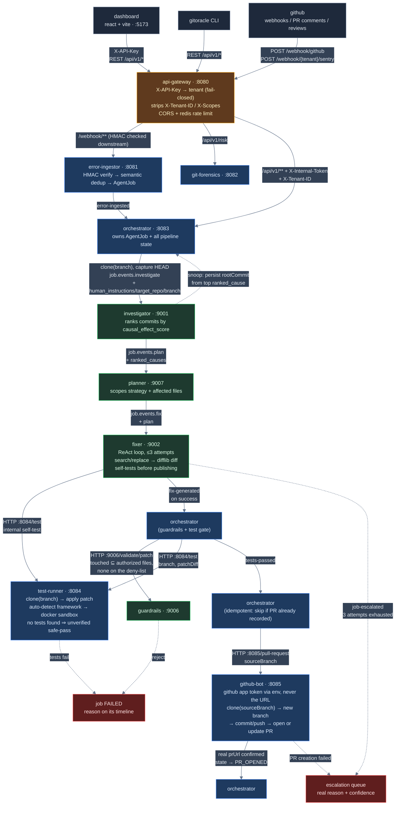
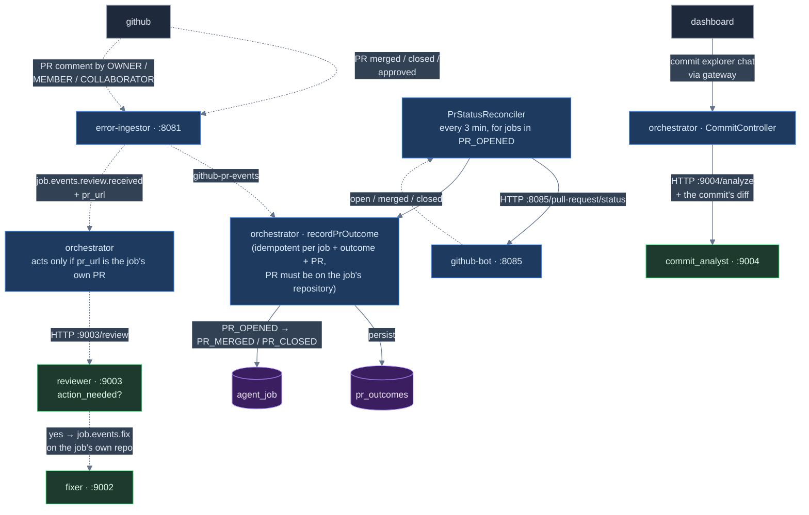
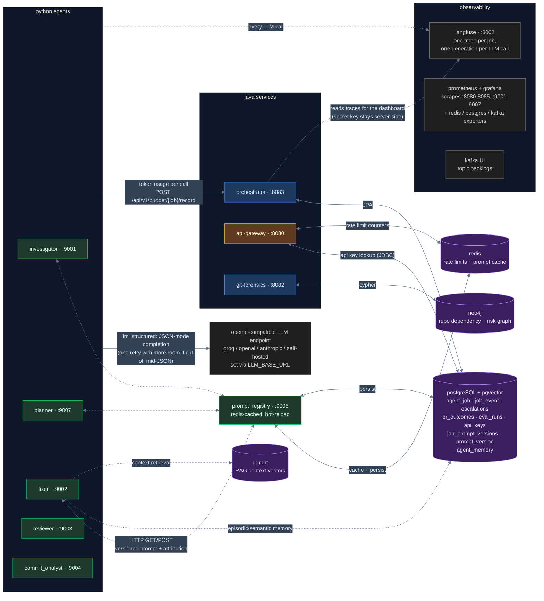
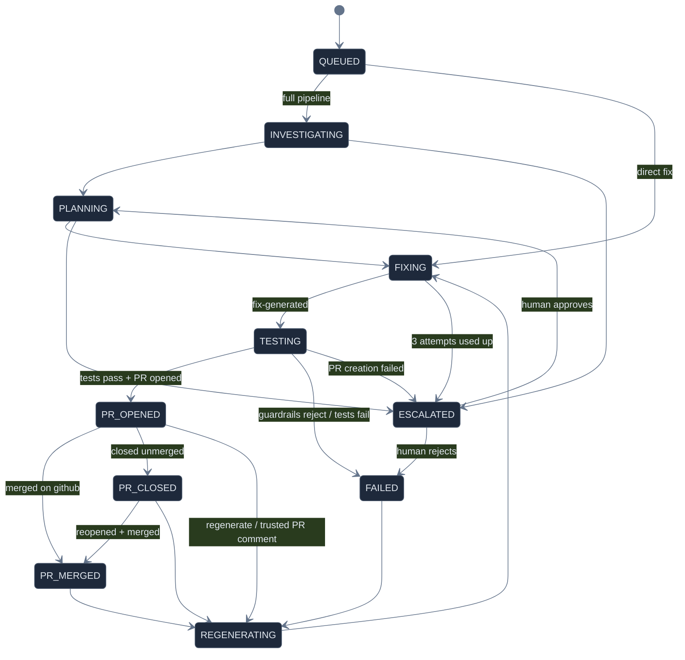
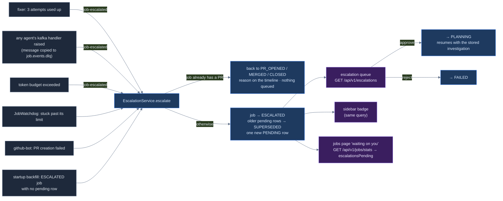
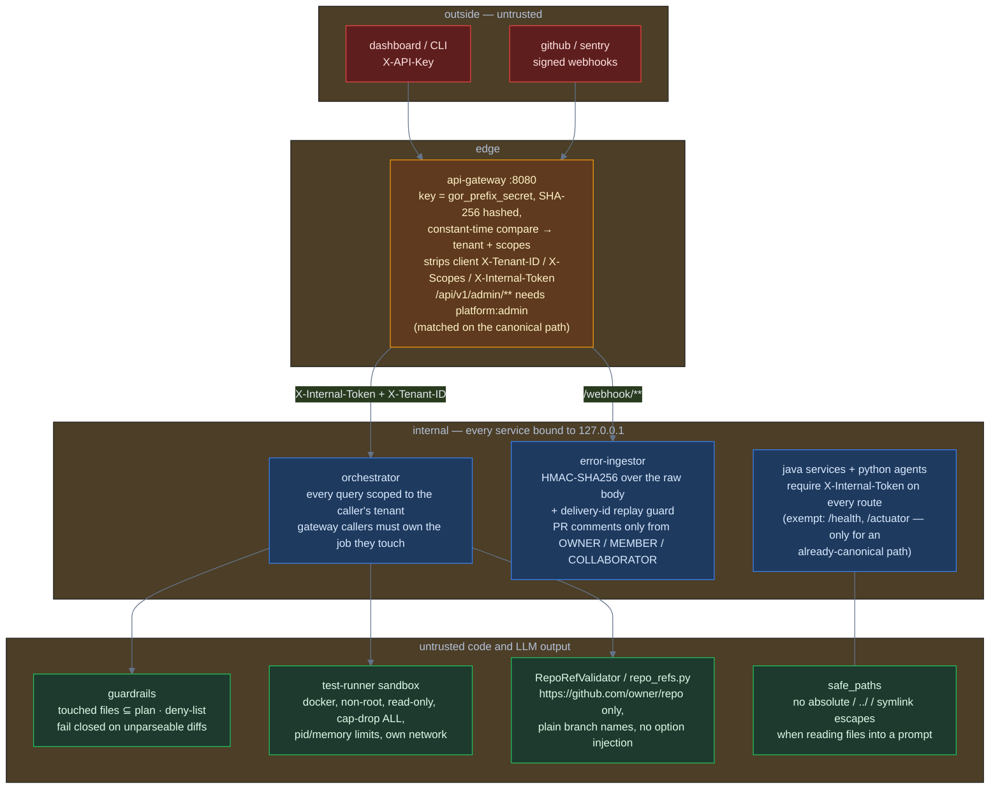
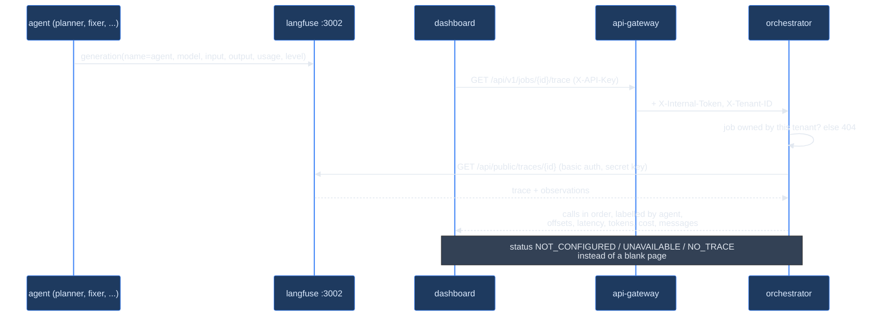

# gitoracle

gitoracle is an event-driven, multi-agent autonomous coding system. point it at a bug — a github webhook, a plain-english description, or a sentry-style error report — and it investigates the root cause across your git history, plans a scoped fix, writes a patch, runs it against your real test suite, and opens a pull request. every step is a durable kafka event, every unsafe or low-confidence outcome is escalated to a human review queue instead of silently failing, and every job's outcome (root cause, prompt version, token spend, PR result) is measured and shown on a live dashboard rather than asserted.

**contents:** [overview](#project-overview) · [features](#key-features) · [tech stack](#tech-stack) · [architecture](#architecture-at-a-glance) · [job lifecycle](#job-lifecycle) · [escalations](#escalations) · [security model](#security-model) · [LLM traces](#llm-traces) · [dashboard metrics](#how-the-dashboard-numbers-are-computed) · [monitoring](#monitoring-prometheus--grafana) · [project structure](#project-structure) · [setup](#deployment--setup) · [interaction flow](#system-interaction-flow) · [API](#core-api-endpoints) · [dashboard](#frontend-dashboard) · [CLI](#cli-reference) · [testing & CI](#testing--ci) · [dev guidelines](#development-guidelines) · [contributing](#contributing) · [license](#license)

## project overview

most "AI fix my bug" tools are a single LLM call wrapped in a nice UI: it sees an error message, guesses a patch, and hopes. gitoracle is built around the belief that autonomous code changes need the same rigor as a human PR review pipeline — root-cause analysis grounded in real git history, a scoped plan before any code is touched, guardrails that block unauthorized file changes, real test execution (not a simulated pass), and a human-in-the-loop escalation path for anything the system isn't confident about.

the system is deliberately decoupled: 6 java spring boot microservices and 7 python fastapi agents communicate almost entirely through kafka topics, plus a handful of synchronous HTTP calls where a hard dependency makes sense (guardrails validation, test execution, PR creation). no service holds the whole pipeline in memory — a job's state lives in postgres, and any service can be killed and restarted without losing the job's place in the pipeline.

## key features

- **two ways to trigger a fix, by design, not by accident.** the dashboard's "ask to fix" form has an "investigate root cause first" toggle: on (default) runs the full investigator → planner → fixer chain (~4,500 tokens, ~25s, real root-cause attribution); off skips straight to the fixer with a synthesized plan (~900 tokens, ~8s) for when a human already knows exactly what to change. both are real, supported paths, not a fallback.
- **root-cause investigation grounded in real git history**, not vibes. the investigator agent ranks actual commits by a causal-effect score against the reported bug, and that ranking — not just `git rev-parse HEAD` — becomes the job's recorded root cause.
- **branch-aware end to end.** every job can target a specific branch — clone, test, and PR base all follow it — not just whatever `git clone` happens to check out by default.
- **strict security guardrails.** a dedicated guardrails service validates every LLM-generated patch's touched files against the plan's authorized file list before anything is applied — an empty allow-list means deny-all, not allow-all — and a hard deny-list (`.git/`, `.github/workflows/`, `.github/actions/`, `.gitmodules`, lockfiles, keys, `.env`) applies even to files the plan authorized.
- **real test execution, not a rubber stamp.** the test runner clones the repo, applies the patch, and runs the actual detected test framework (maven/gradle/pytest/npm/cargo/go) in a hardened docker sandbox (non-root, read-only root, `--cap-drop=ALL`, memory/pid limits). a repo with no test suite is a safe-pass marked *unverified*, not a hard failure.
- **escalation queue, not a black box.** any job an agent can't complete, that stalls, that blows its token budget, or whose PR can't be opened goes to a human-review queue with the real reason attached — and the jobs page, the sidebar badge and the queue always show the same count (see [escalations](#escalations)).
- **multi-tenant by API key.** each API key belongs to a tenant; the gateway derives the tenant from the key and strips any client-supplied tenant header, and every job, trace, escalation and statistic is scoped to it.
- **measured, not asserted, dashboard metrics.** prompt-version success rates, per-agent token spend, PR merge/close rates, and eval-harness accuracy are all computed from real job outcomes in postgres; anything not yet measured shows "—", never a placeholder number (see [how the dashboard numbers are computed](#how-the-dashboard-numbers-are-computed)).
- **LLM traces inside the dashboard.** every prompt, response, token count and latency is traced to langfuse and drawn on the job's page and the LLM traces page — labelled by agent, on one time axis, with failed calls flagged — without leaving gitoracle.
- **commit explorer** with a `commit_analyst` agent you can ask questions about any commit, and a one-click "apply fix as PR" when it spots a regression.
- **dynamic prompt registry** with version history — every job records which exact prompt version each agent ran on, so per-version results are a real join, not a guess.
- **full observability**: langfuse (every LLM call), prometheus + grafana (pipeline, LLM, agent, kafka and service metrics, with alert rules covered by unit tests), kafka UI (topic backlogs).

## tech stack

### java backend (core orchestration) — 6 spring boot 3.2 / java 21 microservices
- **api-gateway** (`:8080`) — the only externally reachable service. authenticates `X-API-Key` (fail-closed), resolves it to a tenant, strips client-supplied identity headers, applies CORS and redis rate limits, then routes.
- **orchestrator** (`:8083`) — the pipeline's brain. owns `AgentJob` state in postgres (every change through `JobStateService`, recorded on the job's timeline), consumes/produces every kafka event, and makes the synchronous calls to guardrails, test runner, and github-bot that gate each stage. also serves the dashboard API, reads LLM traces from langfuse, runs `JobWatchdog` and `PrStatusReconciler`.
- **error-ingestor** (`:8081`) — receives github webhooks (`pull_request`, `pull_request_review`, `workflow_run`, PR comments) and sentry-style error reports, verifies their HMAC signatures, deduplicates via semantic similarity, and kicks off a job.
- **git-forensics** (`:8082`) — serves the risk heatmap's neo4j-backed developer/file risk queries.
- **test-runner** (`:8084`) — clones a repo (optionally at a specific branch), applies a patch, auto-detects and runs the real test framework in a docker sandbox.
- **github-bot** (`:8085`) — authenticates as a github app, clones, branches, commits, pushes, and opens or updates the actual pull request.
- **git-oracle-core** — shared library: JPA entities, kafka topic constants, event DTOs, `RepoRefValidator`, `RequestPaths`. every cross-service contract lives here so services can't silently drift out of sync.

### python AI core — 7 fastapi agents
- **investigator** (`:9001`) — ranks git commits by likely causal effect on the reported bug.
- **planner** (`:9007`) — turns an investigation into a scoped, constrained fix plan (strategy, affected files/functions, max lines to change).
- **fixer** (`:9002`) — runs a ReAct loop (up to 3 attempts) generating a search/replace edit, computes a guaranteed-valid unified diff via `difflib`, and self-tests before publishing.
- **guardrails** (`:9006`) — validates a patch only touches files the plan authorized, and none on the deny-list.
- **reviewer** (`:9003`) — evaluates human PR comments and decides whether they warrant a new fix cycle.
- **commit_analyst** (`:9004`) — answers natural-language questions about a specific commit for the commit explorer.
- **prompt_registry** (`:9005`) — serves versioned system prompts from postgres, redis-cached, with hot-reload on activation.

the investigator, planner and fixer are kafka consumers as well as HTTP servers; the others are HTTP-only. every agent requires `X-Internal-Token` (except `/health`) and makes every LLM call through `shared/structured_output.llm_structured`, which enforces a JSON schema, reports token usage, and traces the call to langfuse.

### infrastructure & storage
- **apache kafka (KRaft mode)** — the event bus every java service and python agent communicates through (topics stored lz4-compressed).
- **postgreSQL + pgvector** — job state and timeline, escalations, PR outcomes, eval runs, prompt versions, API keys, episodic/semantic agent memory.
- **neo4j** — repository dependency/risk graph for the risk heatmap.
- **qdrant** — vector search over codebase snippets for RAG context.
- **redis** — API gateway rate limiting, prompt-registry caching.
- **langfuse, prometheus, grafana, kafka UI** — observability stack.
- **docker compose** — all of the above, one command, memory-capped to run comfortably on an 8GB machine.

## architecture at a glance

the same pipeline, stripped to the 6 stages that matter: an error comes in, gitoracle figures out which commit caused it, plans a fix, writes and tests a patch, then opens a PR. everything else in the detailed diagrams below is what happens *inside* these boxes.



there's also a shortcut: a human who already knows the fix can skip straight to step 4 (see "two entry points" below) — cheaper and faster, but with no root-cause investigation behind it.

## detailed architecture

a top-to-bottom walk of the full pipeline — every service, every kafka topic (named directly on the arrow that carries it), every synchronous HTTP call, and every storage/observability dependency, split into three panels so the labels stay legible: the happy path first, then what happens after a PR exists, then the shared dependencies every agent leans on.

**1 · entry points → the fix pipeline**



**2 · feedback loops — what happens after the PR exists**



the reconciler exists because github can't deliver webhooks to a local deployment; both paths go through `recordPrOutcome`, so whichever arrives second is a no-op. disable it with `GITORACLE_PR_RECONCILER_ENABLED=false`.

**3 · shared dependencies — prompts, inference, storage, observability**



**two entry points into the pipeline, both real:**

1. **`error-ingested` → investigator → planner → fixer** (the "full pipeline"). triggered by a github webhook, a sentry-style report, or the dashboard's "ask to fix" with the investigate toggle on. `handleErrorIngested` clones the repo (at a specific branch if requested), captures HEAD, and dispatches to the investigator — whose top-ranked cause becomes the job's recorded root commit, not just `git rev-parse HEAD`.
2. **`job.events.fix` directly** (the "direct-fix" shortcut). triggered by "ask to fix" with the toggle off. skips investigation entirely with a synthesized plan — ~5x cheaper and faster, correct when a human already knows the fix, but with no root-cause data and no file context beyond what's parsed out of the instruction text.

every override a job can carry — `human_instructions`, `target_repo`, `branch` — is threaded through every kafka hop end-to-end rather than looked up from the database, since these are per-request overrides, not part of a job's durable identity.

## job lifecycle

every state change goes through `JobStateService`, which stamps the time, stores the reason, and appends an event to the job's timeline (shown on the job page). terminal states can only be left along the arrows below — a human asking for another fix (`REGENERATING`), or what a human did to the PR.



`JobWatchdog` (every minute) escalates any job stuck in a working state past its limit (`QUEUED` 5m, `INVESTIGATING` 10m, `PLANNING` 5m, `FIXING` 20m, `TESTING` 15m, `REGENERATING` 20m), counted in `gitoracle_watchdog_escalations_total` with the `JobsStalling` alert. a regeneration of a job that already has a PR never escalates: if the new cycle fails, the job returns to its PR's state with the reason on its timeline, and the existing PR is left unchanged.

## escalations

an escalation is a job waiting on a human. every path that escalates goes through `EscalationService`, which moves the job to `ESCALATED` **and** queues exactly one pending row for it — so the jobs page's "waiting on you", the sidebar badge, and the escalation queue are three views of one number.



approving or rejecting is claimed atomically, so a double click can't resume a job twice, and approving a job that already has a PR is refused (it would open a second one). guardrails rejections and failing tests are **not** escalations — they mark the job `FAILED`, which the jobs page counts separately.

## security model



a few things worth knowing:

- **the github app token never appears in a URL, argv, `.git/config` or an error message.** github-bot hands it to git as an `http.extraheader` through `GIT_CONFIG_*` environment variables, and redacts any credential in a failure before it is logged or stored on a job.
- **revocation is not instant** — the gateway caches key lookups for `GITORACLE_API_KEY_CACHE_TTL_SECONDS` (default 60); restart it to purge immediately. mint/list/revoke keys at `/api/v1/admin/api-keys`.
- **`GITORACLE_API_KEY` is a legacy bootstrap key** with `platform:admin` over the default tenant. mint a real key, then set `GITORACLE_LEGACY_API_KEY_ENABLED=false`; the gateway warns on every boot while it's on.
- **docker is required for tests** — there is no silent unsandboxed fallback. a native fallback exists only behind both `GITORACLE_ALLOW_UNSAFE_NATIVE_TESTS=true` and an exact-match `GITORACLE_TESTRUNNER_TRUSTED_REPOS` entry.
- **known open gap:** every tenant shares one github app installation and nothing yet binds a tenant to a set of repositories, so any tenant key can browse commits of, and target PRs at, any repository the installation can reach. a per-tenant repository allowlist is the planned fix.

## LLM traces

every LLM call goes to langfuse as one generation on the job's trace (trace id = job id), named after the agent that made it, with the model that actually answered, its tokens and latency, and level `ERROR` when the reply didn't match the expected schema. langfuse can't be framed and its API needs the project's secret key, so the dashboard never talks to it directly — the orchestrator reads traces on its behalf, only for jobs the caller's tenant owns.



the viewer shows a summary (calls, tokens in/out, time in the LLM, first→last call, cost, failed calls), a waterfall of every call on one time axis, and each call's response and prompt. it is on each job's page and on the **LLM traces** page, and it polls while a job is still running.

when a provider refuses a JSON-mode request, the agent surfaces the provider's own message (`LLM provider rejected the request (400): ... [json_validate_failed]`) instead of a bare status code. a reply cut off mid-JSON is retried once with double the `max_tokens` (up to `LLM_MAX_TOKENS_CEILING`, default 8192), and a valid JSON object wrapped in a code fence is recovered without another call.

## how the dashboard numbers are computed

| where | number | computed from |
|---|---|---|
| jobs page | total, running, PRs opened, failed | `GET /api/v1/jobs/stats` — counts over **all** of the tenant's jobs (the job list itself is the latest 50) |
| jobs page | waiting on you | `escalationsPending`: pending escalation rows for jobs still `ESCALATED` — the same predicate the queue and sidebar badge use |
| jobs page | % of finished jobs | PR opened or merged ÷ (those + `FAILED` + `PR_CLOSED`); escalated jobs aren't finished |
| evaluations | latest accuracy, eval cases, trend | eval-harness runs (`POST /api/v1/evals`); accuracy = share of cases whose patch the LLM judge scored ≥ 7/10. "—" until a run exists |
| evaluations | regressions | runs that scored lower than the run before them, over the last 6; "—" with fewer than 2 runs |
| evaluations | PR merge rate | merged ÷ (merged + closed) over each job's **current** PR; open PRs reported separately |
| evaluations | PR feedback | each job once, by the strongest outcome of any of its PRs (reverted › merged › closed › approved) |
| evaluations | prompt success rate | finished jobs on that prompt version that opened or merged a PR; running and escalated jobs aren't counted until they finish |
| evaluations | avg tokens / job | that **agent's own** tokens on the job (`job_prompt_versions.tokens_used`, from each LLM call's token report) — not the job's total; "—" for jobs recorded before per-agent tracking |

## monitoring (prometheus & grafana)

`make infra-up` starts prometheus (`http://localhost:9090`) and grafana (`http://localhost:3001`, `GRAFANA_ADMIN_USER` / `GRAFANA_ADMIN_PASSWORD`), with the **GitOracle — Pipeline Health** dashboard provisioned. prometheus scrapes:

| target | endpoint | what it adds |
|---|---|---|
| 6 java services | `/actuator/prometheus` | HTTP, JVM, kafka client metrics; the orchestrator's pipeline metrics below |
| 7 python agents | `/metrics` (no token needed, like `/health`) | LLM calls, latency and tokens per agent; kafka messages and consumer liveness; process memory |
| `redis-exporter`, `postgres-exporter`, `kafka-exporter` | containers in `docker-compose.infra.yml` | redis memory, postgres connections, kafka consumer-group lag |

the pipeline metrics the dashboard and alerts are built on:

| metric | from | meaning |
|---|---|---|
| `gitoracle_job_transitions_total{from_state,to_state}` | orchestrator | every job state change |
| `gitoracle_jobs{state}` · `gitoracle_escalations_pending` | orchestrator | jobs per state and the escalation queue, from the database every 30s |
| `gitoracle_escalations_total{source}` · `gitoracle_watchdog_escalations_total{state}` | orchestrator | escalations queued, and which were stalls |
| `gitoracle_test_runs_total{result}` | orchestrator | `passed` / `failed` / `unverified` (no test suite) / `error` |
| `gitoracle_pr_outcomes_total{outcome}` · `gitoracle_causal_score` | orchestrator | what humans did with PRs; investigator confidence |
| `gitoracle_llm_requests_total{agent,outcome}` · `gitoracle_llm_latency_seconds` · `gitoracle_llm_tokens_total` | agents | every LLM call: `ok` / `schema_error` / `provider_error` / `unavailable` |
| `gitoracle_kafka_messages_total` · `gitoracle_kafka_consumer_up` | agents | consumed messages by result; 1 while a consumer loop is alive |

alerts (`infrastructure/prometheus/rules/gitoracle.yml`, visible at `:9090/alerts`; no alertmanager receiver is configured yet): `JavaServiceDown`, `AgentDown`, `InfrastructureTargetDown`, `AgentConsumerDown`, `JobsStalling`, `LLMCallsFailing`, `EscalationsWaiting`. they are unit-tested with `promtool test rules infrastructure/prometheus/tests/*.yml`.

the dashboard JSON is generated — edit `infrastructure/grafana/scripts/build_dashboard.py` and re-run it; CI fails if the two drift.

**docker on linux:** prometheus reaches the services as `host.docker.internal`, and they bind to `127.0.0.1`. docker desktop (macOS/Windows) forwards that to the host's loopback; docker engine on linux does not, so there either bind the services to `0.0.0.0` behind a host firewall (`SERVER_BIND_HOST` / `BIND_HOST`) or run prometheus with `network_mode: host`.

## project structure

- `java-backend/`: all 6 java microservices, each its own gradle subproject, plus the shared `git-oracle-core` library (JPA entities, kafka topic constants, event DTOs, validators — the single source of truth for cross-service contracts).
- `ai_core/`: the 7 python fastapi agents (`agents/`), shared LLM/kafka/memory/prompt-registry/path-safety helpers (`shared/`), and the regression test suite (`tests/`).
- `dashboard/`: the react + typescript + vite web UI (`src/api/client.ts` is the single axios client every page uses).
- `cli/`: the `gitOracle` terminal client.
- `eval/`: the golden dataset generator (`setup_test_repo.py` — 6 seeded bugs, each on its own `case/<id>` branch of a github fixture repo, with generated golden patches) and harness (`run_evals.py`, `check_regression.py`).
- `infrastructure/`: postgres init SQL, kafka topic creation, prometheus rules/config, grafana provisioning.
- `scripts/ci/`: shared CI helpers (`write_env.sh`, `start_stack.sh`, `e2e_check.py`).
- `docker-compose.infra.yml`: the backing infrastructure stack (kafka, postgres, neo4j, qdrant, redis, langfuse, prometheus, grafana, kafka UI) — memory-capped per container.
- `docker-compose.services.yml`: containerized alternative to running the java services as local processes, including a dedicated docker-in-docker daemon for the test sandbox.
- `start_local.sh` / `stop_local.sh`: bring up/tear down every java service and python agent as local processes, each under a restart loop. `stop_local.sh` exists specifically because a naive `lsof -ti :<port> | xargs kill` also matches `com.docker.backend` (prometheus holds a live connection to every scraped port) and will crash docker desktop — it filters strictly by command name instead.
- `llm-server/`: *(deprecated)* previously held local `llama.cpp` config; inference is now routed to any openai-compatible endpoint via `LLM_BASE_URL`.

## deployment & setup

### prerequisites
- java 21 (JDK)
- python 3.11+
- node.js 18+
- docker & docker compose (required — tests only run in the docker sandbox)
- an openai-compatible LLM API key (groq, openai, anthropic, or self-hosted) — set `LLM_BASE_URL`, `LLM_MODEL_NAME`, and `OPENAI_API_KEY` in `.env`.
- 8GB RAM minimum. the full stack (9 infra containers + 6 java services + 7 python agents + dashboard) is memory-capped to fit: `java-backend/gradle.properties` caps build/daemon memory and disables the gradle daemon, `start_local.sh` caps each service's JVM heap, and `docker-compose.infra.yml` sets a `mem_limit` on every container. there's little headroom left for other heavy apps running at the same time. 16GB+ gives comfortable margin instead of a tight fit.

### getting started

1. **clone the repository** and navigate into the root directory.

2. **configure environment**
   ```bash
   cp .env.example .env
   ```
   fill in, all in this one root `.env`:
   - `LLM_BASE_URL` (the **full** chat-completions URL, e.g. `https://api.groq.com/openai/v1/chat/completions`), `LLM_MODEL_NAME`, `OPENAI_API_KEY`
   - nothing for `GITORACLE_API_KEY` (the bootstrap key for scripts and the first sign-in) or `GITORACLE_INTERNAL_TOKEN`: `./start_local.sh` replaces their placeholders with random values in `.env`. every service refuses to start on a placeholder, so if you start them another way, generate your own with `openssl rand -hex 32`.
   - `GITHUB_APP_WEBHOOK_SECRET` / `SENTRY_WEBHOOK_SECRET` if you send webhooks — unsigned or wrongly signed deliveries are rejected
   - `LANGFUSE_PUBLIC_KEY` / `LANGFUSE_SECRET_KEY` for LLM traces (optional; without them the trace views say tracing is off)
   - for real PR creation, your GitHub App: `GITHUB_APP_ID`, `GITHUB_INSTALLATION_ID`, and `GITHUB_PRIVATE_KEY_PATH`. Put the key in `secrets/` (gitignored) in **PKCS#8** form — GitHub gives you PKCS#1, convert once with `openssl pkcs8 -topk8 -nocrypt -in downloaded.pem -out secrets/github-app.pem`. A relative path is resolved from the repo root.

   (`java-backend/github-bot/.env` used to hold the GitHub App settings; it still works, with a deprecation warning, but the root `.env` takes priority.)

3. **launch infrastructure**
   ```bash
   make infra-up
   ```

4. **initialize backend & AI core**
   ```bash
   ./start_local.sh
   ```
   this builds every java service's jar (~10 minutes the first time) and starts all 6 java services, all 7 python agents, and the dashboard as local processes. after a restart, confirm a java service is ready by grepping its log for `Started <X>Application` rather than curling its port. alternatively, run the java services as containers instead:
   ```bash
   docker compose -f docker-compose.services.yml up -d --build
   ```
   to stop everything safely (without risking docker desktop — see the note on `stop_local.sh` above):
   ```bash
   ./stop_local.sh
   ```

5. **interact with gitoracle**
   open the dashboard (`http://localhost:5173`) and sign in with GitHub, or with an API key if that isn't set up (see [sign-in](#sign-in)). your generated key is `GITORACLE_API_KEY` in `.env`. the **developer guide** link at the top of every page (`/guide`, no sign-in needed) lists every way to use and connect gitoracle. from there:
   - **ask to fix** — describe a bug in plain english, optionally pick a branch, choose whether to run full investigation or the fast direct path, and watch it turn into a PR.
   - **jobs / job page** — live state, the job's timeline, its LLM trace, and "regenerate fix" with your own instructions.
   - **commit explorer** — browse commit history, inspect diffs, chat with `commit_analyst` about any commit.
   - **escalation queue** — review jobs the pipeline couldn't resolve, with the real reason attached.
   - **evaluations** and **LLM traces** — real accuracy, PR outcome, token and per-call data.
   - then mint per-tenant keys at `/api/v1/admin/api-keys` and turn the legacy key off (see [security model](#security-model)).

## system interaction flow

a concrete walkthrough of the full-pipeline path, e.g. fixing a bug reported via a github actions workflow failure:

1. **ingestion.** the gateway routes the `workflow_run` webhook to error-ingestor, which verifies its `X-Hub-Signature-256` over the raw body, drops a replayed delivery id, builds an internal payload (`repo`, `error_id`, `stacktrace`), and calls `SemanticDedupService.ingest()`, which persists an `AgentJob` and publishes `error-ingested`.
2. **clone + dispatch.** the orchestrator's `handleErrorIngested` reuses that job (never creates a duplicate row), clones the repo — at a specific branch if the job requested one — captures the real HEAD SHA, and publishes `job.events.investigate` carrying the raw error payload, any human instructions, and the target branch.
3. **investigation.** the investigator agent analyzes recent git history for the affected area, ranks candidate commits by `causal_effect_score`, and publishes `job.events.plan`. the orchestrator snoops this handoff to persist the investigation result **and** promote the top-ranked cause to the job's `rootCommit` — the actual measured root cause, not just HEAD.
4. **planning.** the planner agent turns the investigation into a scoped `PlannerOutput` (strategy, affected files/functions, max lines to change, confidence) and publishes `job.events.fix`.
5. **fixing.** the fixer agent runs a ReAct loop (up to 3 attempts): generates a search/replace edit via the LLM, computes a guaranteed-syntactically-valid unified diff via python's `difflib` (never an LLM-authored diff, which was unreliable), self-tests against test runner, and on success publishes `fix-generated`. a retry is told which test failed and why. on exhausting all attempts, it publishes `job-escalated` with the real failure reason and the planner's own confidence score.
6. **guardrails.** the orchestrator calls guardrails synchronously to confirm the patch only touches files the plan authorized — from the plan, never from the LLM completion that wrote the patch — and nothing on the deny-list. a rejection marks the job `FAILED`.
7. **official test verification.** the orchestrator calls test runner independently (in addition to the fixer's own internal self-test) — clones the target branch fresh, applies the patch, auto-detects and runs the real test framework in the sandbox. a repo with no test suite at all is a safe-pass marked unverified, not a failure; failing tests mark the job `FAILED`.
8. **PR creation.** on tests passing, the orchestrator calls github-bot, which authenticates as a github app, clones the source branch, cuts a new `gitoracle-fix-<jobId>` branch from it, commits, pushes, and opens a PR with that branch as the base — not always the repo's default branch. the PR description carries the job's real numbers (causal confidence, attempts, test counts). a regenerated fix for a job whose PR is still open is pushed onto that PR's branch instead of opening a second PR. the orchestrator only marks the job `PR_OPENED` (with the real `prUrl`) once github-bot confirms success; this is idempotent against kafka's at-least-once redelivery. if PR creation fails, the job is escalated with the (redacted) reason.
9. **outcome tracking.** when that PR is merged or closed, the `pull_request` webhook — or, for a local deployment github can't reach, `PrStatusReconciler` polling github-bot every 3 minutes — goes through `recordPrOutcome`, which stores a `pr_outcome` row and moves the job to `PR_MERGED` / `PR_CLOSED`.
10. **review comments.** a comment on the job's own PR by an owner, member or collaborator is sent to the reviewer agent; if it agrees a change is needed, the job goes `REGENERATING` and a new fix cycle runs against the job's repository with the comment as instructions.

## core API endpoints

routed through the api-gateway (`:8080`) and scoped to the caller's tenant unless noted otherwise.

- `POST /webhook/github` — github app webhook receiver (PRs, PR reviews, workflow failures, PR comments); HMAC-verified.
- `POST /webhook/{tenantId}/sentry` — sentry-style error report ingestion; HMAC-verified.
- `POST /api/v1/trigger` — "ask to fix": `{ repoUrl, issueDescription, targetRepo?, branch?, investigateFirst? }`. returns `mode: "full-pipeline"` or `"direct-fix"` depending on `investigateFirst`.
- `GET /api/v1/jobs` / `GET /api/v1/jobs/{id}` — latest 50 jobs / one job.
- `GET /api/v1/jobs/stats` — counts by state over all jobs, plus `escalationsPending`.
- `GET /api/v1/jobs/{id}/events` — the job's timeline (state changes and agent progress notes).
- `GET /api/v1/jobs/{id}/trace` — the job's LLM calls, read from langfuse (`status`: `OK` / `NO_TRACE` / `NOT_CONFIGURED` / `UNAVAILABLE`).
- `GET /api/v1/traces` — recent jobs with a summary of each trace.
- `POST /api/v1/jobs/{jobId}/feedback` — "regenerate fix" with new human instructions.
- `GET /api/v1/escalations` / `POST /api/v1/escalations/{id}/resolve` — pending escalations; `{ "action": "approve" | "reject" }`.
- `GET /api/v1/commits?repo=owner/repo` / `GET /api/v1/commits/{sha}/diff?repo=` / `POST /api/v1/commits/{sha}/analyze?repo=` — commit explorer data and `commit_analyst` chat.
- `GET /api/v1/risk` — neo4j-backed developer/file risk data (routed to git-forensics).
- `GET /api/v1/pr-outcomes/stats` — merge rate over decided PRs plus per-outcome counts; `null` rate until a PR is merged or closed.
- `GET /api/v1/prompts/stats` — per-prompt-version success rate and per-agent average tokens.
- `GET /api/v1/evals` / `POST /api/v1/evals` — eval harness run history.
- `GET /api/v1/budget/{jobId}` — a job's token budget.
- `/api/v1/admin/**` (requires `platform:admin`) — tenants, tenant config, prompt activation, and `POST` / `GET` / `DELETE /api/v1/admin/api-keys`.
- **service-internal** (not gateway-routed, `X-Internal-Token` required): `POST :9006/validate/patch` (guardrails), `POST :8084/test` (test runner), `POST :8085/pull-request` and `GET :8085/pull-request/status` (github-bot), `POST /api/v1/budget/{jobId}/record`, `POST /api/v1/jobs/{id}/events`, `POST /api/v1/jobs/{id}/prompt-version` (from agents), `GET :9005/prompts/{agent}/{key}` and `.../active`, `PUT :9005/prompts/{agent}/{key}/activate/{version}`.

## frontend dashboard

react + typescript + vite. pages:

- **jobs** — every job with live state, token usage and reason; headline counts over all jobs; filters for running, PR opened, escalated and failed.
- **job page** — the pipeline stepper, the job's timeline, its PR, "regenerate fix", and its full LLM trace.
- **ask to fix** — trigger a job: repo, branch, instructions, target PR repo, and the investigate-first toggle with an inline explanation of the cost/speed tradeoff.
- **repositories** — client-side registered repo shortcuts (localStorage), pre-fills other pages.
- **commit explorer** — browse commits, expand diffs, chat with `commit_analyst`, one-click "apply fix as PR".
- **escalations** — jobs waiting on a human, with the real reason, approve/reject, and a live count in the sidebar.
- **risk heatmap** — neo4j-backed developer/file risk visualization.
- **evaluations** — accuracy trend, PR merge rate and feedback, per-prompt-version results — all computed from real data, "—" where nothing's been measured.
- **LLM traces** — every job's LLM calls, drawn in the dashboard (see [LLM traces](#llm-traces)).
- **webhook simulator** — hand-craft and fire a github webhook payload at the real ingestion endpoint for testing.
- **settings** — dark/light mode, token budget config.
- **API keys** — create and revoke keys for your scripts.
- **developer guide** — how to get access, run your own copy, and start jobs from other tools. linked at the top of every page.

### sign-in

if you fork gitoracle, your copy is separate: nobody issues you a key, and `./start_local.sh` generates your own in `.env`.

people sign in with github; API keys are for scripts, the CLI and CI. to turn it on, in your GitHub App's settings set the callback URL to `http://localhost:8080/api/v1/auth/github/callback` and generate a client secret, then set in `.env`:

- `GITHUB_APP_CLIENT_ID` and `GITHUB_APP_CLIENT_SECRET`
- `GITORACLE_ADMIN_GITHUB_IDS` — your numeric github id (the `id` at `https://api.github.com/users/<login>`). admins work in the default tenant.
- `GITORACLE_INVITED_GITHUB_USERS` — logins of anyone else, comma-separated. each gets an empty tenant of their own; add repositories to it with `POST /api/v1/admin/repos`.

when hosting, also set `GITORACLE_PUBLIC_API_URL`, `GITORACLE_DASHBOARD_URL` and `GITORACLE_ALLOWED_ORIGINS` to your real https addresses.

a sign-in lasts 7 days and survives reloads. the session is in an `httpOnly` cookie that page scripts can't read.

once that's set up, the login page offers github only. until then it shows an API key form, which holds the key in memory for the tab only, so reloading signs you out. to get back in if github sign-in breaks, blank `GITHUB_APP_CLIENT_ID` and restart.

### API keys

keys are for scripts and CI. after signing in, create them on the **API keys** page: each one is shown once, belongs to your tenant, can't do admin work, and expires (90 days by default, 1 year at most). revoking one takes effect within a minute. a key can't create or revoke other keys. operators can still use `/api/v1/admin/api-keys`.

## CLI reference

the `gitOracle` CLI (`cli/gitOracle/main.py`) provides terminal-based control. it talks to the api-gateway at `http://localhost:8080/api/v1` (not yet configurable via flag or env var).

> **it does not send `X-API-Key` yet**, and the gateway is fail-closed, so every command that calls the API is currently rejected with 401. `gitoracle config set-key <key>` saves a key to `~/.gitoracle/config.json` (mode `0600`) but nothing reads it back. wiring that key into the requests is the first fix the CLI needs.

commands that call a real endpoint (once authenticated):
- `gitoracle analyze --repo <url> --commit <hash>` — `POST /api/v1/jobs`.
- `gitoracle fix --repo <url> --commit <hash> --error <msg> --file <path> --line <num>` — `POST /api/v1/trigger` (full pipeline: it doesn't send `investigateFirst: false`).
- `gitoracle watch --job <uuid>` — polls `GET /api/v1/jobs/{id}`.
- `gitoracle jobs list` — `GET /api/v1/jobs`, most recent 15.
- `gitoracle commits --repo <url>` — `GET /api/v1/commits`; sends `repoUrl`, but the endpoint expects `repo=owner/repo`, so it is rejected with 400.

**stub output, not a live call** — in violation of this project's own "never fabricate a success state" rule (see [development guidelines](#development-guidelines)); treat these as placeholders until fixed:
- `gitoracle status` — prints a hardcoded table of six services all "✓ HEALTHY" with made-up latencies; it makes no request at all.
- `gitoracle eval --golden-dir <dir> [--report <file>]` — runs a local progress bar and prints a hardcoded `94%`. the real harness is `python eval/run_evals.py` (see [testing & CI](#testing--ci)).
- `gitoracle prompts list --agent <name>` — prints three hardcoded rows (`v3.2` / `v3.1` / `v3.0`); never calls `prompt_registry`.
- `gitoracle prompts activate --agent <name> --version <version>` — sleeps and prints success without calling anything.

## testing & CI

every push and PR to `main` runs [`.github/workflows/ci.yml`](.github/workflows/ci.yml); every job is blocking:

| job | what it does |
|---|---|
| `secret-scan` | gitleaks over the repository |
| `python-lint` | `ruff check ai_core cli/gitOracle eval --select E9,F`, `ruff --select BLE001` over `ai_core/agents` + `ai_core/shared` (no unexplained blanket `except`), and `mypy ai_core/agents` |
| `python-agent-tests` | `pytest ai_core/tests/` — no test calls a real LLM |
| `java-tests` | `./gradlew test` across all modules (unit + testcontainers) |
| `dashboard-build` | `npm ci`, `npm run lint` (oxlint), `npm run build` |
| `cli-check` | installs the CLI and runs `gitOracle --help` |
| `monitoring-config` | `promtool check config` / `check rules`, the alert-rule unit tests, and a check that the grafana dashboard JSON matches its generator |
| `pipeline-e2e` | brings up the real stack with the LLM replaced by `ai_core/tests/mock_llm_server.py`, runs eval case 1 end to end against the fixture repo's `case/npe` branch, and asserts the timeline and patch (`scripts/ci/e2e_check.py`); skipped for PRs from forks |

[`.github/workflows/eval.yml`](.github/workflows/eval.yml) runs the golden dataset eval nightly (03:00 UTC) and on demand against a real LLM: it publishes the 6-case fixture repo as the GitOracle github app, runs every case through `POST /trigger` (the full pipeline), and gates on patch accuracy (LLM judge ≥ 7/10 vs the golden patch) and cause accuracy (the investigator's top commit is the bug commit). it is configured by the `EVAL_LLM_*`, `GITORACLE_APP_ID` and `GITORACLE_APP_PRIVATE_KEY` secrets and the `EVAL_FIXTURE_REPO` variable.

locally:
```bash
# java — one module or one test
cd java-backend
./gradlew :orchestrator:test --no-daemon
./gradlew :orchestrator:test --no-daemon --tests "ai.gitoracle.orchestrator.OrchestratorServiceTest"

# python — full suite or one file
cd ai_core && source .venv/bin/activate
pytest ai_core/tests/
pytest ai_core/tests/test_build_unified_diff.py -v

# dashboard
cd dashboard && npm run lint && npm run build
```
note: `ai_core/test_*.py` at the package root (`test_fixer.py`, `test_investigator.py`, etc.) are standalone manual smoke scripts run directly with `python`, not part of the pytest suite — the real regression suite is `ai_core/tests/` only.

there is currently no test-coverage reporting, SAST, or dependency-vulnerability scanning in CI (dependabot keeps actions and npm dependencies current).

## development guidelines

- **event-driven first.** prefer asynchronous kafka events over synchronous REST calls between services. the few exceptions (guardrails validation, test runner, github-bot) are deliberate: the orchestrator needs to block on their result before deciding the job's next state.
- **shared core module.** any new JPA entity, kafka topic constant, or event DTO goes in `git-oracle-core` — never duplicate a contract across services.
- **state through `JobStateService`, escalations through `EscalationService`.** never `job.setState(...)` directly, and never set `ESCALATED` without going through `EscalationService` — that is exactly how a job ended up escalated but missing from the queue.
- **idempotency is not optional.** kafka delivers at-least-once. any handler that mutates job state or calls an external system (PR creation, outcome recording) must tolerate being invoked twice for the same event without corrupting state or double-acting — see `handleTestsPassed`'s PR guard and `recordPrOutcome`'s `existsByJobIdAndOutcomeAndPrUrl` check for the pattern.
- **tenancy comes from the API key.** request-scoped code takes the tenant from `TenantContext`; kafka listeners take it from the event payload. any new route a gateway caller can reach must check the caller owns the job it touches.
- **never fabricate a success state or a dashboard metric.** if something can't be measured yet, show "—" — a plausible-looking number that isn't real is worse than an honest gap.
- **regression tests for anything that failed silently once.** `ai_core/tests/` and `java-backend/*/src/test/` exist specifically to pin bugs that were confirmed live and could easily reintroduce themselves — a test that can't be shown to actually fail without the fix isn't worth adding.
- **commit history.** atomic commits with the actual root cause and how it was confirmed in the message — not just what changed.

## contributing

no `CONTRIBUTING.md` yet. in the meantime: follow the [development guidelines](#development-guidelines) above, keep PRs scoped to one root cause, and make sure `./gradlew test --no-daemon` (java), `pytest ai_core/tests/` (python) and `npm run lint && npm run build` (dashboard) pass locally before opening one — see [testing & CI](#testing--ci).

## license

no `LICENSE` file is present in this repository yet. until one is added, treat the code as all-rights-reserved by default — don't assume permissive reuse.
